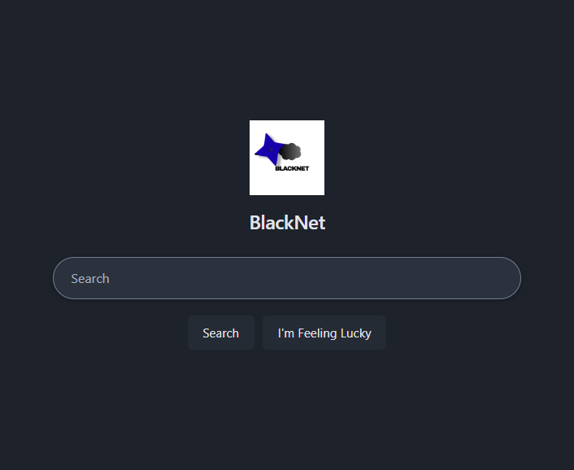

# BlackNet

BlackNet is an experimental browser project with desktop and Android shells,
request blocking, an optional separately run proxy gateway, and a local
credential vault. Its privacy controls are limited and are not an anonymity
system; see the [threat model](#threat-model) before relying on them.

| Path | What it is | Runtime |
| --- | --- | --- |
| `netops-desktop/` | Desktop browser shell: tabs, settings, vault, request policy, and optional proxy supervision | Electron 44 (Chromium 152) + a C++20 N-API policy addon |
| `netops-android/` | Android browser shell with a separately implemented policy port | Kotlin + Android System WebView (minSdk 26) |
| `proxy-rotator/` | Optional rotating proxy gateway; requires operator-provided upstreams | Python 3.11+ |
| `netops/` | Separate legacy Python application, retained with its own service, imports, and tests; not launched by the desktop shell | Python |

## Runtime overview

The desktop shell runs the native policy addon in-process. If the operator
enables the rotator, it launches the separate Python gateway:

```
Electron shell ── optionally spawns ──> rotator serve -c rotator.toml
     │                          │
     │ HTTP 8888 / SOCKS5 1080 <-┘  (the browser's proxy)
     │ HTTP 9099 /status  <───────  (health, exit IPs)
     └── C++ addon: URL policy, tracker blocklist, cookies, cache index
```

The rotator is optional and proxying is not enabled by default; without an
explicit proxy configuration, browser traffic may go directly to the network.
The desktop shell does not use the legacy `netops/` application, and does not
start a localhost dashboard or control-plane web server. The default search
submits queries from the main process to the public APIs listed in
[`search.js`](netops-desktop/src/main/search.js); it is not local-only search.

## Screenshot

The desktop new-tab page content (the browser toolbar is not shown):



## Features, and how far each one is honestly finished

| Feature | State |
| --- | --- |
| Tabs, profiles, navigation, address bar | Working. Drag a tab sideways to reorder it (the strip previews the move, and the new order survives a restart); middle-click closes, `+` opens a fresh one. The Chrome keyboard layer is answered from both the page and the chrome: Ctrl+T new tab, Ctrl+W close, Ctrl+Tab / Ctrl+Shift+Tab cycle (wrapping), Ctrl+1..8 jump to that tab, Ctrl+9 to the last |
| Search | Working. The new-tab page is a clean search home. By default, the main process sends each query to public, keyless JSON APIs (Wikipedia, Hacker News, Stack Overflow, GitHub) and displays merged results in a built-in page. Those services receive the query. Settings > Search engine can instead route it to DuckDuckGo, Bing, or Google. The default is limited to those sources; it does not search the whole web |
| Tracker blocking (56 rules) with a live per-tab count | Working |
| Privacy grade (0-100) and host-level report, JSON export | Working, **not persisted** — it is cleared on exit |
| Rotating proxy: start/stop, health probing, exit IP display | Optional and off by default. Real rotation needs provider credentials and more than one distinct healthy exit IP (see below); otherwise traffic may be direct |
| Encrypted vault, per-record AES-256-GCM | Working |
| OS step-up: Windows Hello + DPAPI, macOS system authorization prompt, Linux sudo | Implemented with platform-specific paths; native-device validation is still needed |
| Session restore | Working. Stores URLs and the active tab, nothing else; opt out in Settings |
| Settings schema | One typed table; reads and writes validated identically |
| `.onion` addresses refused before any request | Working. The tab keeps the address and shows a "site can't be reached" page; the rule is main-process knowledge and is never put on the IPC map |
| Shell-side circuit self-check | Working, off by default. The shell's own client proves the local circuit carries a request instead of trusting an open port; main-process only and never on the IPC map |
| Selected Chromium hardening | Enables `no-pings`, the `NoReferrers` and `ThirdPartyStoragePartitioning` features, disables non-proxied WebRTC UDP, and disables background networking. These selected controls are not equivalent to LibreWolf's full set of protections |
| Clock pinned to UTC | Working, best-effort. `Date.getTimezoneOffset` and `Intl.DateTimeFormat().resolvedOptions().timeZone` answer UTC in every tab, injected at document start into the page's own world (no preload, so the no-bridge rule holds) and the process `TZ` is set at startup. Engine-level formatting paths are out of reach, so it is one switch among many rather than a guarantee |
| Letterboxing | Working. The page viewport is rounded down to a configurable 200 x 100 grid and centered; this reduces variation in reported viewport dimensions but does not prevent fingerprinting. The address bar keeps the full window width |
| Third-party storage partitioning | Requests Chromium's `ThirdPartyStoragePartitioning` feature to key supported third-party storage by top-level site. This is limited to Chromium's implementation and is not a guarantee of Tor-style first-party isolation |
| New Identity & clear-on-exit | Working. New Identity closes every tab and wipes cookies, cache and HTTP auth for every profile in use, then opens one blank tab; clear-on-exit runs the same wipe when the browser quits. Off by default, and deliberately not a loop over tab-close, which would race the erase by opening a replacement tab |
| Bookmarks (star + bar) | Working. The star in the address bar bookmarks the active `http(s)` page and fills a Chrome-style bookmarks bar below the toolbar; the bar reports its own height so the page below is pushed down instead of overlapped. Right-click a bar item to remove it. Stored in `bookmarks.json`, kept separate from the restorable session |
| Find in page | Working. Ctrl+F opens a find bar below the toolbar, focuses its box and counts matches as they arrive (`n/m`, or "no matches"); Enter and the arrows step forward and back, Escape closes it. The bar reports its own height so the page moves down, and the highlight is cleared when the tab is left. Caught in the main process while a page holds the keyboard |
| Zoom (per site) | Working. Ctrl `+`/`-`/`0` steps the active site through Chromium's zoom ladder and resets it; every tab on the same origin moves together and the size is remembered across restarts. A chip in the address bar shows the percentage when a site is not at 100% and resets it on click. Stored per origin in `zoom.json`; local pages with no origin stay at 100% |
| Downloads | Working. A navigated attachment is saved automatically to the system Downloads folder with a safe name (path separators, drive letters and `..` stripped, duplicates get ` (1)`), and every save survival is recorded in `downloads.json` (capped at 200 records). The tray shows active rows with a live percentage while a download runs and keeps finished rows until dismissed (click one to open it); Ctrl+J or the "Downloads" button opens the full list page. Cancel stops a save mid-way and drops the partial file. Clearing the list forgets records, never files |
| Android shell | Working. The verdict chain is a statement-for-statement port (onion first, then URL, host and tracker rules), refusal page wording identical, tracker blocks counted per tab; 45 JVM tests |
| History (Android) | Working. Local SQLite, newest first, one row per URL, capped at 2000: tap to open, long-press to delete, Clear empties it. Refused targets and tracker URLs are never recorded |

Not built, and not pretending to be: per-site fingerprint profiles, request
rewriting, a shared fingerprint marketplace, any AI layer.

Desktop browsing history and browser extensions are not implemented. Android
has a separate local history feature; this does not imply desktop history support.

## Threat model

BlackNet's controls are intended to reduce some routine browser risks. They are
not a promise of anonymity, complete tracking prevention, or protection from a
compromised device.

### Implemented protections

- Applies URL, host, and tracker rules in the desktop native policy layer and
  an independently implemented policy in the Android shell. The desktop
  built-in tracker list contains 56 patterns; it is not EasyList or EasyPrivacy.
- Refuses `.onion` destinations rather than connecting to them. This browser
  does not provide Tor routing.
- Denies browser permissions by default and applies Chromium settings intended
  to limit non-proxied WebRTC UDP, cross-site referrers, and third-party storage.
- Provides a credential vault using AES-256-GCM, a fresh 96-bit IV per record,
  and associated data bound to the record id, origin, and username. Unlocking
  requires the configured platform step-up path.
- Offers optional clear-on-exit for cookies, cache, and site storage. It is
  off by default; session restore is separately enabled by default and stores
  open tab URLs.

### What it does not protect against

- **Direct network exposure:** proxying is optional and off by default.
  Provider credentials and a working gateway are the operator's responsibility.
  The current implementation has not been verified to provide a complete
  fail-closed guarantee or prevent DNS leaks in every configuration. A proxy
  provider can observe connection metadata and unencrypted traffic.
- **Anonymity and correlation:** BlackNet is not Tor Browser. It does not
  provide onion routing, network-wide anonymity, traffic-analysis resistance,
  or a guarantee that sites cannot identify a user.
- **Fingerprinting:** UTC pinning and letterboxing cover selected browser
  surfaces only. They do not make devices indistinguishable and are not a
  comprehensive fingerprinting defense.
- **Complete tracker blocking:** the built-in list is small and finite. It can
  miss trackers or block legitimate requests; it is not a maintained,
  automatically updated community filter list.
- **A compromised OS or local account:** malware, a malicious administrator,
  or someone with access to an unlocked desktop session may access browser
  data. Profile storage, cookies, and cached site data are not represented as
  encrypted by the credential-vault guarantees.
- **Data retention by default:** desktop session restore is enabled by default,
  and clear-on-exit is opt-in. The Android history is stored locally until
  cleared. Search queries are sent to the configured public APIs or selected
  external search engine.
- **Device-specific guarantees:** Android uses the system WebView, and a
  physical-device test has not been reported. Windows and Linux step-up paths
  also need platform-specific validation beyond unit tests.

These boundaries describe the checked-in implementation, not a security
certification. See [`docs/AUDIT.md`](docs/AUDIT.md) for the repository audit
snapshot and [SECURITY.md](SECURITY.md) for reporting vulnerabilities.

## Proxy credentials

Upstream lists live in `proxy-rotator/pools/`, which is gitignored. Passwords are
referenced from the environment rather than written down:

```
198.51.100.10:8080:${RES_USER:-alice}:${RES_PW}#weight=3,tag=isp
```

- `${VAR}` is required. An unset or empty value is a startup error that names the
  variable, because `socks5://:@host` looks exactly like a broken proxy.
- `${VAR:-default}` is optional, for pools where only some entries need auth. The
  example above has no default for the password on purpose — an authenticated
  upstream with no password configured is a mistake worth stopping for.

Passwords never reach the pool file, the status endpoint, the logs or the UI. The
gateway's own labels are redacted to `user:***@host`, and expansion happens before
parsing so that an error can quote a scheme without quoting a credential.

Check what is actually being used:

```sh
cd proxy-rotator
.venv/bin/rotator validate -c rotator.toml   # config parses, N upstreams
.venv/bin/rotator check -c rotator.toml      # probe each, print real exit IPs
.venv/bin/rotator bench -c rotator.toml      # measure rotation
```

The browser's Settings tab shows the same thing, and states the verdict in terms
of observed exit addresses: *rotating* requires more than one distinct exit. A
pool of healthy upstreams that all resolve to one address is reported as
**one exit IP - not rotating**, because that is what it is.

## Security model

- Vault records: AES-256-GCM, fresh 96-bit IV per record, AAD bound to storage id,
  origin and username. Listing entries never decrypts.
- The vault key is not derived from a password: Windows uses a Hello presence
  check and DPAPI at rest; macOS uses a system authorization prompt; Linux uses
  sudo to read a `0600` root-owned key file. Native platform flows need
  end-to-end validation; the macOS vault-key path is not verified here.
- Step-up is required to reveal or copy, not to list.
- Password capture is one-way and origin-validated; the page's own URL is all the
  hook may observe. Private and loopback origins are refused.
- The sudo password is never written to disk, logged, or returned to the renderer.
  It is transmitted exactly once per step-up.
- Ordinary web tabs get no preload at all. Only the shell's own pages and the
  password hook's remote-content exception get a bridge.
- Search runs in the main process: by default a query goes to a fixed set of
  public APIs, and only the merged list reaches the results page. That page is a
  plain file with no bridge, so nothing a source returns can turn into a
  capability. An opted-in external engine (Settings > Search engine) turns a
  query into a normal navigation to that engine's fixed URL pattern; the engine
  name comes from the settings schema, so a tampered value falls back to the
  default rather than inventing a URL to visit.
- Telemetry is host-level and in memory: no full URLs, paths or query strings are
  stored or exported. Search queries are not written to the session file either,
  because a saved session that reopens onto them is a search history.

## Requirements

- Debian/Ubuntu with `python3.13` and `libpulse0` (audio), WSLg on Windows
- Node 20 or newer for the tests; the shell itself brings its own runtime
- Electron 44 (Chromium 152, Node 24). Supported Electron lines only — a browser
  that loads arbitrary sites is exactly where an unpatched Chromium matters.
- A C++20 toolchain for the native addon (CMake)
- `python3.13` for the rotator if you use it
- JDK 17+ and the Android SDK (platform 35) for `netops-android/`

`npm install` does not download the Electron binary any more: since Electron 42
that happens in a `postinstall` script, which npm's supply-chain rules have
removed. The first `npm start`, `npm test` or `npm run smoke` fetches it, and
`npm run rebuild:native` fetches it first because the build wants the version on
disk to be the one being built against.

The addon is N-API, so it does not have to match Electron's Node. It is compiled
against the system `node` headers and resolves the ABI from whichever process
loads it. It must **not** link `libnode`: two V8s in one process segfault the
shell on startup, before any of our code runs.

## Development

```sh
cd netops-desktop
npm install
npm test                       # contrast check (palettes + every renderer CSS) + ctest (40) + node:test (350)
npm run smoke                  # real Electron window, headless, 129 checks
bash tools/check_syntax.sh     # JS syntax + the node:test suite + repo hygiene

cd ../proxy-rotator
.venv/bin/python -m pytest     # 76 tests

cd ../netops-android
gradle test                    # 45 JVM unit tests over the policy core and history
gradle assembleDebug           # debug APK (app/build/outputs/apk/debug/)
gradle assembleRelease         # signed, R8-minified APK (see below)
gradle lintDebug               # static analysis of the shell
```

Release builds for `netops-android/` are signed from `keystore.properties`,
which points at `blacknet-release.jks`. Both are gitignored: the keystore is
the app's identity, and losing it means an installed app can never be updated
in place — back it up somewhere the repository is not. Without them
`assembleRelease` still runs, producing an unsigned APK. The release build is
R8-minified to about a sixth of the debug size; it is built and lint-clean but
has never run on a physical device, so `app-debug.apk` stays the fallback.

`tools/check_syntax.sh` is the gate that runs everything that runs without a
display. `npm run smoke` is the one that exercises a real window, a real
`WebContentsView`, a real preload contract and the C++ policy, including a forced
renderer crash.

`tools/check_contrast.py` audits both palettes *and* every stylesheet in
`src/renderer` that defines its own `:root` tokens, in each scheme it declares.
A stylesheet that inlines its colours instead of importing `palette.css` is
therefore held to the same WCAG targets, and it self-tests on every run so a
parsing change cannot turn the audit into a silent pass.

## Windows installer

`netops-desktop/tools/package-win.ps1` builds `BlackNet-Setup-<version>.exe`
(NSIS, per-user, no admin) on Windows:

- Prerequisites: Node + npm, CMake, and a MinGW-w64 toolchain (e.g. WinLibs)
  with `mingw32-make`, `gendef` and `dlltool` on PATH. No Visual Studio needed:
  the addon is pure N-API.
- The script stages a clean copy of the repo (excluding `node_modules`, `build`,
  `dist` and state), runs `npm ci`, fetches N-API headers with `node-gyp`,
  builds the C++ policy addon with MinGW, and packages with electron-builder.
  On Windows a DLL must resolve every symbol at link time, so the addon links an
  import library generated from the packaged binary's own exports
  (`BlackNet.exe`) instead of leaving N-API open like ELF and Mach-O may.
- Output: `dist\BlackNet-Setup-0.1.0.exe` plus `dist\win-unpacked\BlackNet.exe`.
- Silent install/uninstall: `BlackNet-Setup-0.1.0.exe /S`.

## Runtime files

Per-machine state, none of it tracked:

- `<userData>/settings.json` — preferences, validated against the schema
- `<userData>/session.json` — the saved tab list
- `<userData>/vault/` — the encrypted vault
- `<userData>/identity.json` — the local profile name (no password)
- `proxy-rotator/pools/` — upstream lists